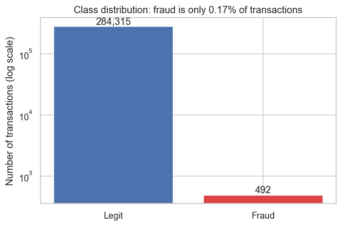
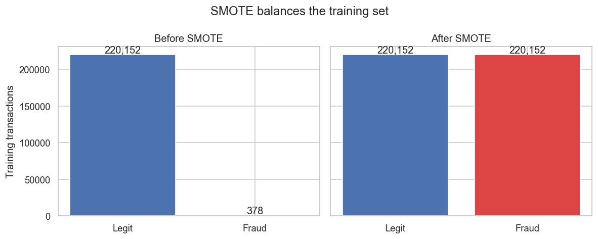
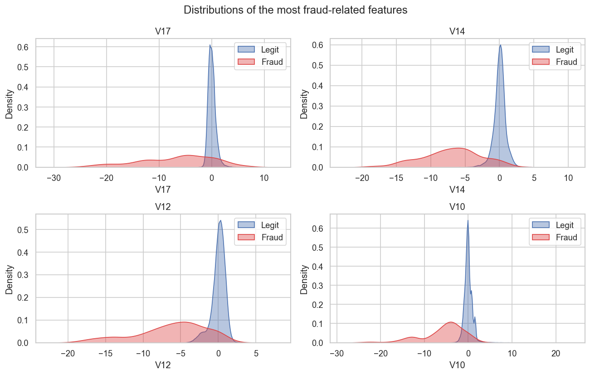
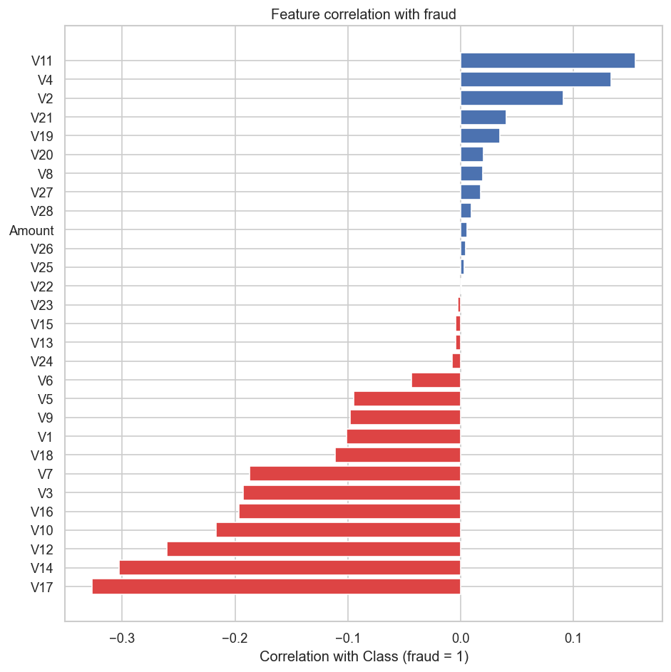
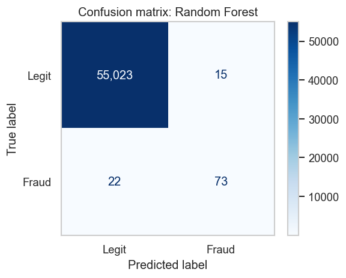
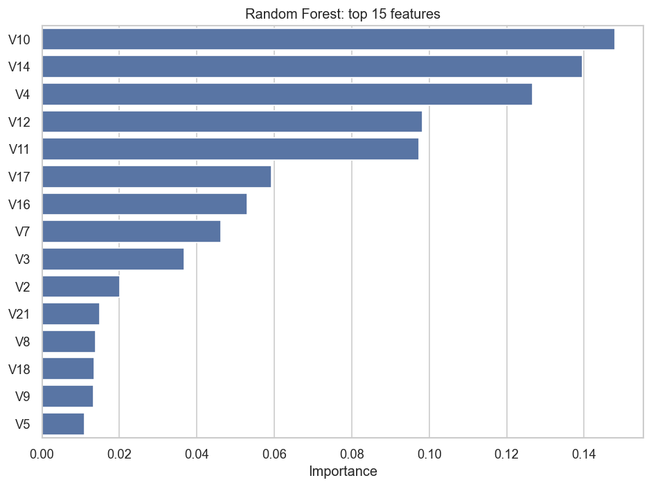
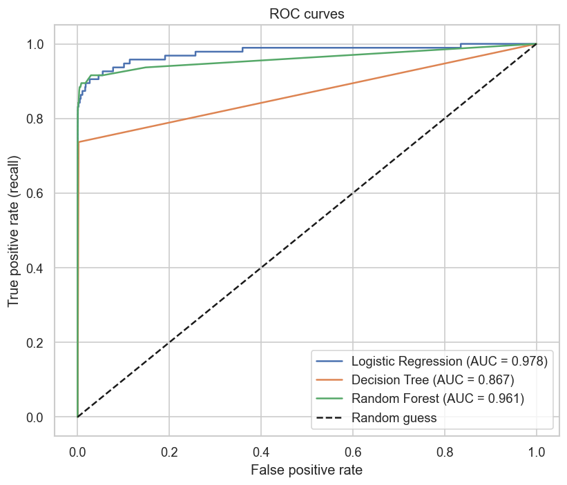
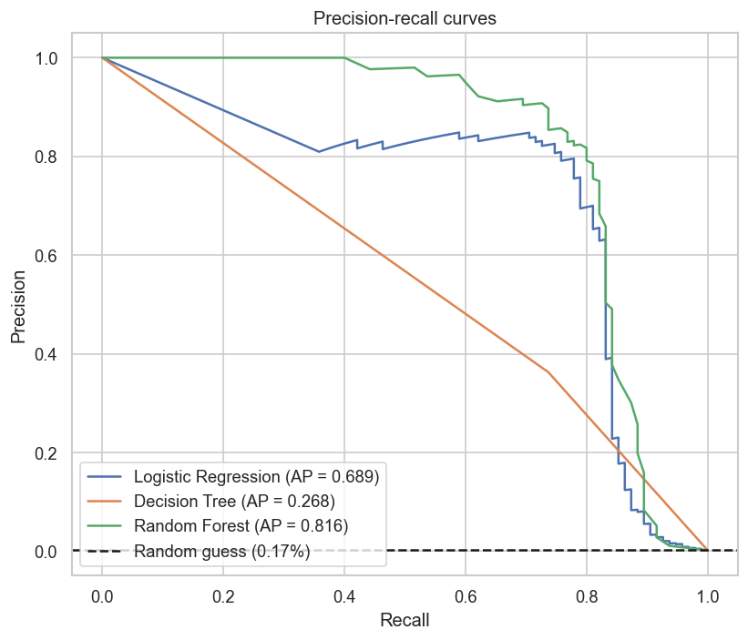

# Credit Card Fraud Detection

Detecting fraudulent credit card transactions with supervised machine learning, on a real-world dataset where only
**0.17%** of transactions are fraud.


## Overview

With 284,807 transactions and only 492 frauds, a model that always predicts "not fraud" would be 99.8% accurate and
completely useless. This project focuses on the metrics that matter for imbalanced data (recall, precision, F1 and
PR-AUC) and covers the full workflow:

1. **Exploratory data analysis:** class imbalance, transaction amounts, and which features separate fraud from
   legitimate transactions
2. **Handling class imbalance** with SMOTE, applied only to the training data inside a pipeline to avoid data
   leakage
3. **Model comparison:** Logistic Regression, Decision Tree and Random Forest
4. **Evaluation:** confusion matrices, ROC and precision-recall curves, feature importance and threshold trade-offs
5. **SQL analysis:** model predictions are loaded into SQLite to flag high-risk transactions and quantify false
   alarms

## Results

Evaluated on a held-out, stratified test set of 55,133 transactions (95 frauds) that was never resampled:

| Model | Precision | Recall | F1 | ROC-AUC | PR-AUC |
|---|---|---|---|---|---|
| Logistic Regression | 0.057 | 0.895 | 0.107 | 0.978 | 0.689 |
| Decision Tree | 0.363 | 0.737 | 0.486 | 0.867 | 0.268 |
| **Random Forest** | **0.830** | 0.768 | **0.798** | 0.961 | **0.816** |

**Key findings**

- **SMOTE raised Logistic Regression's recall from 0.57 to 0.90**, catching 85 of 95 test frauds instead of 54.
- **Random Forest is the best overall model:** it caught 73 of 95 frauds with only 15 false alarms out of 55,038
  legitimate transactions (a 0.027% false alarm rate).
- **ROC-AUC alone is misleading here.** Logistic Regression has the highest ROC-AUC (0.978), but about 94% of its
  alerts are false at the default threshold. PR-AUC exposes this.
- **Reviewing the riskiest 1% of transactions finds 89.5% of all fraud**, which gives a fraud team a practical way
  to prioritise its work (see the SQL analysis).

## Visualisations

| | |
|---|---|
|  |  |
|  |  |
|  |  |
|  |  |

All 14 charts are in the [`images/`](images) folder.

## SQL analysis

The Random Forest's test-set predictions are loaded into an SQLite database and queried with SQL to answer business
questions:

| Question | SQL techniques |
|---|---|
| How many frauds were caught or missed, and how many false alarms were raised? | `CASE`, conditional aggregation |
| Which transactions should the fraud team review first? | filtering, ordering |
| How do fraud rate and model performance vary by transaction amount? | `CASE` bands, `GROUP BY` |
| If the team reviews only the riskiest 1%, how much fraud is found? | CTEs, `NTILE()`, `SUM() OVER` window functions |
| Which missed frauds were larger than the average fraud? | subqueries |

## Project structure

```
credit-card-fraud-detection/
├── notebooks/
│   └── credit_card_fraud_detection.ipynb   # full analysis, with explanations
├── src/
│   └── download_data.py                    # downloads the dataset
├── images/                                 # saved charts
├── data/                                   # dataset (not tracked in git)
├── requirements.txt
└── README.md
```

## How to run

```bash
git clone https://github.com/tanishadahale/credit-card-fraud-detection.git
cd credit-card-fraud-detection
pip install -r requirements.txt
python src/download_data.py
jupyter notebook notebooks/credit_card_fraud_detection.ipynb
```

The dataset (about 150 MB) is too large for GitHub, so `download_data.py` fetches it from
[OpenML](https://www.openml.org/d/1597).

## Dataset

[Credit Card Fraud Detection](https://www.kaggle.com/datasets/mlg-ulb/creditcardfraud): 284,807 transactions made
by European cardholders over two days in September 2013, collected by the Machine Learning Group of ULB (Université
Libre de Bruxelles).

- `V1`–`V28` are anonymised features produced by PCA to protect customer privacy.
- `Amount` is the transaction amount, and `Class` is the label (1 = fraud).
- The OpenML copy used here has no `Time` column.

Reference: Andrea Dal Pozzolo, Olivier Caelen, Reid A. Johnson and Gianluca Bontempi. *Calibrating Probability with
Undersampling for Unbalanced Classification.* IEEE Symposium on Computational Intelligence and Data Mining (CIDM),
2015.

## Author

**Tanisha Dahale**: [GitHub](https://github.com/tanishadahale) ·
[LinkedIn](https://linkedin.com/in/tanisha-dahale-396597319)
